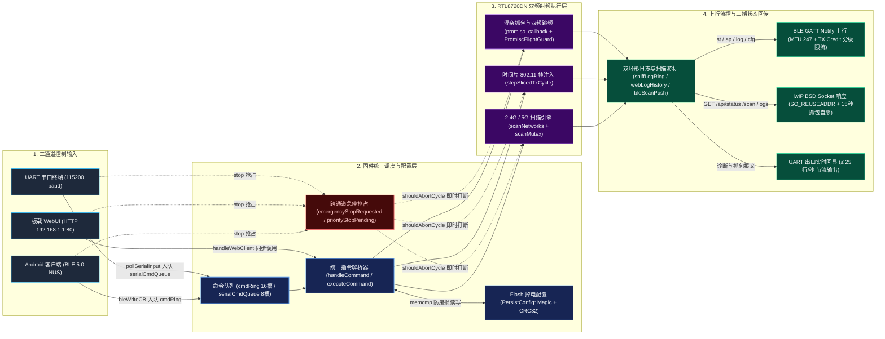

# WiFi-Deck

[](https://github.com/xiangwen-ctrl/WiFi-Deck/actions/workflows/android.yml)
-blue)


基于 **Ai-Thinker BW16-Kit（Realtek RTL8720DN）** 的便携式 2.4GHz / 5GHz 双频 Wi-Fi 测试与 802.11 协议分析工具。  
在 [Evil-BW16](https://github.com/7h30th3r0n3/Evil-BW16) 的基础上重写了固件调度与通信链路，支持 **BLE 5.0 Android 客户端**、**板载 WebUI** 和 **UART 串口** 3种控制方式，开发板上不用接屏幕或按键就能直接用。用手机蓝牙连接控制时，手机可以正常走移动数据上网，开发板抓包、跳频或关闭热点隐身时也不会断联。

> ⚠️ 本项目仅用于无线安全教学、802.11 协议研究及已获得明确授权的测试场景，请勿用于任何未授权的网络干扰，使用者需自行承担相应法律责任。

---

## 界面预览

### Android 客户端（BLE 5.0）

<p align="center">
  
  &nbsp;&nbsp;
  
</p>

### 板载 WebUI（`http://192.168.1.1`）

<p align="center">
  
</p>

### 三端功能对照

| 模块 | Android 客户端（BLE 5.0，推荐） | 板载 WebUI（`http://192.168.1.1`） | UART 串口 CLI（`115200`） |
|---|---|---|---|
| 状态栏 | BLE 连接态、重连进度、当前信道、热点/目标/TX 统计、一键急停 | 定时轮询 `/api/status`、运行状态、TX 计数、BLE 在线提示、一键急停 | 打印启动诊断、信道切换、TX 统计与 `stop` 急停 |
| 扫描页 | 2.4G / 5G 频段计数过滤、SSID/BSSID 搜索、RSSI 排序、多选/全选 | 2.4G / 5G 标签、信号条、动态扫描倒计时、多目标勾选 | `scan`、`results`、`set target <i,j\|all>` |
| 控制页 | Deauth / Disassoc / 单目标点射 / Flood / Jam / 定时测试、运行态高亮 | 已选目标概览、定时压测、零目标拦截与单目标点射 | `start deauther`、`disassoc`、`single_ap`、`attack_time`、`beacon_flood`、`probe_flood`、`signal_jam`、`deauth_sniff` |
| 抓包页 | 6种过滤模式、自动跳频、常用双频信道锁定、滚屏锁、导出分享、同步清空 | 查看历史 `/api/logs`；Web 端开启抓包会自动按15秒定时并在结束后重连恢复 | `start sniff`、`sniff <mode>`、`sniff_time`、`hop on/off`、`set ch`、`clear_logs` |
| 设置页 | 自定义 BLE 名称 / 热点 SSID / 密码（写 Flash，按 `RST` 重启生效）、`ap off` 隐身开关 | 修改运行参数、密码脱敏读取（留空不改）、恢复默认（禁止 `ap off` 防断联） | `set <key> <val>`、`ap on/off`、`info`、`reset_config` |

---

## 硬件与控制方式

### BW16-Kit 硬件说明

**Ai-Thinker BW16-Kit** 开发板采用安信可 BW16 模组（核心 SoC 为 **Realtek RTL8720DN**，内置 **ARM V8 KM4 + ARM V8M KM0** 双核，分别兼容 Cortex-M4F 与 Cortex-M0），单颗芯片集成了：
- **2.4GHz + 5GHz 双频 Wi-Fi（802.11 a/b/g/n）**：支持 2.4GHz（CH 1–13）与 5GHz（CH 36–165），可跑 SoftAP 热点、STA 双频扫描、原始管理帧注入和混杂模式监听；
- **BLE 5.0 低功耗蓝牙**：与 Wi-Fi 共用天线但协议栈独立，Wi-Fi 切信道抓包或关热点时蓝牙依然能正常通信；
- **板载外设**：Type-C 供电（建议 `5V > 500mA`）与 **CH340C** USB 转串口（接 `PA7_LOG_TX` / `PA8_LOG_RX`）、三色 RGB LED（`PA12` / `PA13` / `PA14`）、`RST` 复位键和 `BURN` 烧录键。

官方资料已整理在 [docs/hardware/](docs/hardware/) 目录，需要查引脚或电路可以直接打开：
- [BW16-Kit_V1.2.3_Specification.pdf](docs/hardware/BW16-Kit_V1.2.3_Specification.pdf)（开发板规格书：引脚定义、电气与射频参数、按键与 LED 说明）
- [BW16-Kit_V1.2_Schematic.pdf](docs/hardware/BW16-Kit_V1.2_Schematic.pdf)（V1.2 原理图：Type-C / CH340C 自动下载电路与 GPIO 连接）
- [BW16_V1.2.2_Datasheet_CN.pdf](docs/hardware/BW16_V1.2.2_Datasheet_CN.pdf)（BW16 模组中文规格书：RTL8720DN 架构、天线与供电设计）

### 为什么推荐用蓝牙（BLE 5.0）控制？

开发板本身只有一套 Wi-Fi 射频前端，如果靠连接板载 `WiFi-Deck` 热点来操控（WebUI），会遇到两个实际问题：
1. 板载热点不接外网，单无线网卡的电脑连上后就没法再通过 Wi-Fi 上网，手机通常也只能靠移动数据；
2. 一旦进入混杂模式抓包或者用 `ap off` 关掉热点隐身，板载 Wi-Fi 热点必然断开，网页控制台也就跟着失联了。

走 **BLE 5.0 蓝牙控制（Android App）** 可以把控制链路和 Wi-Fi 射频拆开：
- 开发板上不用焊接屏幕或按键，插上 USB 电源或充电宝就能工作，所有操作都在手机里完成；
- 手机走蓝牙控制不占用 Wi-Fi，可以继续用 4G/5G 移动数据（或正常连家里的路由器 Wi-Fi）上网；开发板抓包跳频或关热点隐身期间，蓝牙连接也一直在线，随时能看报文和一键急停；
- 在 App 内点顶部“连接”即可自动扫描直连，不用去手机系统蓝牙设置里手动配对；BLE 数据通道和蓝牙耳机的音频通道（A2DP / HFP）互相独立，连着板子时照样可以戴蓝牙耳机听歌通话。

### 三种控制方式对比

| 控制方式 | 怎么连 | 适用场景 |
|---|---|---|
| **BLE 5.0 Android App（主力推荐）** | 打开 App 点顶部“连接”即可 | 不占 Wi-Fi（手机可正常上网）、不影响蓝牙耳机；支持后台保活、断线自动重连、抓包流实时导出以及 `ap off` 隐身模式，适合日常和外出使用。 |
| **板载 WebUI** | 连热点 `WiFi-Deck`（密码 `12345678`），打开 `http://192.168.1.1` | 不用装 App，手机或电脑浏览器都能直接用；抓包时会自动定时15秒并在结束后恢复热点（单网卡电脑连此热点期间无法通过 Wi-Fi 上外网）。 |
| **UART 串口 CLI** | USB 接电脑串口，波特率 `115200` | 可用全部底层命令并直接看串口运行/内存日志，适合桌面调试和开发。 |

---

## 系统架构

### 整体结构



### 固件端实现细节（`WiFi-Deck.ino`）

- **指令入口与跨通道急停**  
  BLE 写回调 `bleWriteCB` 运行在蓝牙协议栈线程中，收到指令后会写入带临界区保护的16槽环形队列 `cmdRing`，避免阻塞蓝牙任务；串口输入由 `pollSerialInput` 非阻塞读入8槽队列 `serialCmdQueue`，两者都在主循环 `loop()` 里交给 `handleCommand` / `executeCommand` 顺序执行。Web 端请求（`handleWebClient`）则在解析 `/api/command` 等接口后同步调用 `executeCommand(..., fromHttp = true)`，以便立即返回 HTTP `200`/`400`/`403` JSON 状态。  
  只要任意通道收到 `stop`，就会立刻置位 `emergencyStopRequested` 和 `priorityStopPending`。发包循环由时间片状态机 `stepSlicedTxCycle` 驱动（每次最多切片发送8帧并喂狗），配合 `shouldAbortCycle()` 在扫描等待与发包间隙检查急停标志，实现随时打断。
- **并发安全与防误攻**  
  异步扫描回调 `scanResultHandler` 与主循环之间通过 FreeRTOS 互斥锁 `scanMutex` 同步；通过 `pumpBleScanPush` 游标状态机在主循环里分步推送热点列表，防止热点较多时阻塞主循环。混杂抓包引入了在途回调计数 `PromiscFlightGuard`（`promiscCallbackInFlight`），切信道、发送克隆帧或退出混杂模式前会等在途回调完全结束；抓包文本经 UTF-8 裁剪后分别写入24槽实时流缓冲 `sniffLogRing`（推给 BLE/串口）和32槽历史缓冲 `webLogHistory`（供 `/api/logs` 单次拷贝 4KB 快照后拼装 JSON）。  
  `wifi_tx_raw_frame` 对驱动内部结构体做逐级判空与帧长（`<= 1500B`）校验，Beacon/Probe 构造器限制 SSID `<= 32B` 与96B 栈缓冲边界；App 与 WebUI 下发攻击时必须带目标索引（如 `start deauther 0,2,5`），未选目标直接拒绝，全量发包需要显式传 `all`。
- **BLE 上行分级背压限流**  
  抓包高峰期如果无限制地发 Notify 会耗尽协议栈 TX credit，把每秒1次的 `st` 心跳饿死并触发 `0x0108` 超时断连。`bleSendSniffLog` 和主循环对此做了分级流控：`EAPOL`、`Deauth`、`Disassoc` 与 `Pwnagotchi` 帧只要还有 `>= 1` 个 credit（间隔 `>= 15ms`）就优先发送；普通日志则要求至少保留3个 credit 给心跳和命令响应，并根据 ATT MTU 在 `100ms–800ms` 之间动态退避。
- **WebUI 端口自愈与 Flash 掉电记忆**  
  Web 服务直接使用 lwIP BSD Socket（开启 `SO_REUSEADDR` 和连接排空，用 `#undef` 隔离宏冲突）。纯 WebUI 用户点抓包时，固件先完整发出 HTTP 200 再关闭热点进入15秒定时抓包，结束后自动拉起 SoftAP 并重绑80端口，网页倒计时结束自动重连读取 `/api/logs`。配置保存使用 `PersistConfig`（含 `CFG_MAGIC` `0x57444B33`、版本号与 `CRC32` 校验），`saveConfigToFlash` 会先用 `memcmp` 比对，参数没变时不重复擦写 Flash。

### Android 客户端实现细节（`AndroidApp/`）

- **GATT 串行状态机与断线重连**  
  `BleManager` 把“扫描 NUS Service UUID → 发起 `TRANSPORT_LE` 建链 → 错峰400ms 请求 `MTU = 247` → 发现服务 → 写 CCCD 开启 Notify → 自动下发 `info` 与 `results` 同步状态”串成带超时的单线流水线，并通过有界写队列与 `WriteAckTracker`（`60ms` 写确认超时、最小 `25ms` 间隔，`stop` 队首插队）控制下发节奏。意外断线后，`BleReconnectTracker` 会先用缓存设备尝试1次 `4.5s` 快速直连，失败立刻切回 BLE 扫描（按 MAC 地址锁定刚才那块板子，最多退避重试5轮），同时监听系统蓝牙开关广播防止竞态卡死。
- **后台保活与 UTF-8 字节分帧**  
  连接或重连期间自动启动 `connectedDevice` 类型前台服务 `BleKeepAliveService`，防止手机息屏或切后台后系统断掉蓝牙；上行分片由 `BleLineFramer`（单行上限 `4096B`）先按字节攒够整行 `\n` 再解码 UTF-8，避免中文热点名跨包被切坏成乱码。
- **主线程顺序消费与 75ms 合批渲染**  
  BLE 回调收到的数据先写入 `Channel`，由 `MainViewModel` 在主线程顺序消费（每轮最多处理64条后 `yield()`），避免多线程读写状态冲突；抓包日志和扫描列表通过500槽 `ArrayDeque` 与 `LinkedHashMap` 按 `75ms` 周期合批刷新，配合派生 `StateFlow` 与 `SaveableStateProvider` 隔离各页重组，高负载抓包下界面也能保持流畅。

---

## 快速开始

### 硬件与编译环境

- **开发板**：**Ai-Thinker BW16-Kit**（RTL8720DN），请用支持数据传输的 USB 线接电脑或独立供电口。
- **固件环境**：Arduino IDE 2.x 或 `arduino-cli`，安装 **Realtek Ameba Boards (AmebaD)** **`3.1.7`**，开发板管理器地址：
  ```text
  https://github.com/ambiot/ambd_arduino/raw/main/Arduino_package/package_realtek_amebad_index.json
  ```
- **Android 环境**：手机需 **Android 8.0+**（`minSdk 26`，`targetSdk 36`）；从源码编译需 **JDK 17+** 与 **Android SDK 36**（Build Tools `35.0.0`）。

### 烧录固件

1. Arduino IDE 打开根目录 `WiFi-Deck.ino`，开发板选 **`Ai-Thinker BW16 (RTL8720DN)`**。
2. **进入下载模式**：按住板载 **`BURN`** 键不放 → 短按一下 **`RST`** 键 → 松开 **`BURN`** 键。
3. 选好串口点上传即可（串口监视器波特率 **`115200`**）。

命令行编译与烧录（`arduino-cli`）：
```bash
arduino-cli compile --clean --fqbn realtek:AmebaD:Ai-Thinker_BW16 --warnings all .
arduino-cli upload -p COM6 --fqbn realtek:AmebaD:Ai-Thinker_BW16 .
```

### 连接与使用

- **Android 客户端（推荐）**：前往 [GitHub Releases](https://github.com/xiangwen-ctrl/WiFi-Deck/releases/latest) 或 [Gitee Releases](https://gitee.com/xiangwen-ctrl/WiFi-Deck/releases) 下载 **`WiFi-Deck-v2.0.apk`** 安装，按提示授予蓝牙/附近设备权限（Android 8–11 需同时开启定位）后在 App 内点顶部连接按钮即可（不用在系统蓝牙里配对，手机可继续上网，也不影响蓝牙耳机）。
- **板载 WebUI**：手机或电脑连上热点（默认名称 **`WiFi-Deck`**，密码 **`12345678`**），浏览器打开 **`http://192.168.1.1`**。
- **UART 串口**：波特率 `115200`，发 `help` 可看完整命令列表。
- **本地编译 App 与跑单元测试**：
  ```bash
  cd AndroidApp
  ./gradlew testDebugUnitTest assembleDebug --no-daemon
  ```
  > Windows PowerShell 请将 `./gradlew` 换为 `.\gradlew.bat`，编译后的安装包在 `AndroidApp/app/build/outputs/apk/debug/app-debug.apk`。

---

## 目录与协议参考

### 目录结构

```text
WiFi-Deck/
├── WiFi-Deck.ino                          # RTL8720DN 固件源码（射频收发/混杂抓包/BLE NUS/lwIP WebUI/UART CLI）
├── AndroidApp/                            # Android 客户端 (Kotlin + Jetpack Compose + MVVM)
│   └── app/src/
│       ├── main/java/io/github/xiangwen/wifideck/
│       │   ├── MainActivity.kt            # 权限/蓝牙/定位门禁链与系统蓝牙广播监听
│       │   ├── data/
│       │   │   ├── BleManager.kt          # BLE 扫描、连接、MTU 协商、串行写队列与超时控制
│       │   │   ├── BleReconnectTracker.kt # 断线重连状态机（快速直连切扫描 + 退避）与 ACK 追踪
│       │   │   ├── BleProtocol.kt         # UTF-8 字节级换行分帧器与 MTU 载荷编解码
│       │   │   ├── BleKeepAliveService.kt # connectedDevice 前台保活服务
│       │   │   └── Models.kt              # 状态、配置、热点与抓包日志数据模型
│       │   └── ui/
│       │       ├── MainViewModel.kt       # 业务状态流、75ms 日志合批节流与防误攻校验
│       │       ├── MainScreen.kt          # 底部四标签页导航与页面状态保持
│       │       ├── components/            # 顶部遥测仪表盘、门禁弹窗与公共卡片
│       │       ├── tabs/                  # ScanTab / ControlTab / SniffTab / SettingsTab
│       │       └── theme/                 # 暗色主题配色
│       └── test/java/io/github/xiangwen/wifideck/
│           ├── data/BleProtocolTest.kt
│           ├── data/BleReconnectTrackerTest.kt
│           ├── data/ModelsTest.kt
│           └── ui/MainViewModelTest.kt
├── docs/
│   ├── hardware/                          # BW16-Kit 官方规格书与原理图 PDF
│   └── screenshots/                       # Android 客户端与 WebUI 界面截图
├── .github/workflows/android.yml          # 单元测试、APK 构建与 Tag 自动发版 CI
├── LICENSE
└── README.md
```

<details>
<summary>📡 展开查看：完整串口/BLE 控制指令、BLE JSON Lines 协议与 HTTP API</summary>

#### 1. 统一控制指令（UART / BLE 共用，单条上限 219B，串口以 `\r` / `\n` 结尾）
```text
# 扫描与查询
scan                        results                     info                    help
tx_stats                    reset_txstats

# 射频测试（未选目标拒绝无参攻击，全量测试需显式传 all）
start deauther <i,j|all>    disassoc <i,j|all>          single_ap <index>       random_attack
attack_time <ms> <i,j|all>  stop [all|deauther]

# Flood / Jam / 嗅探克隆
beacon_flood                probe_flood                 signal_jam              deauth_sniff

# 混杂抓包与信道跳频
start sniff                 sniff all|beacon|probe|deauth|eapol|pwnagotchi
sniff_time <ms> [mode]      stop sniff                  clear_logs
hop on                      hop off                     set ch <channel>

# 参数配置与热点控制（写入 Flash 掉电记忆；ap off 仅允许 BLE 与串口）
set target <i,j,k|all>      set num_frames <n>          set cycle_delay <ms>    set scan_time <ms>
set start_channel <c>       set scan_cycles on|off      set led on|off          ap on|off
set ble_name <name>         set ap_ssid <ssid>          set ap_pass <pass>      reset_config
```

#### 2. BLE GATT（Nordic UART Service）与上行 JSON Lines
- **Service UUID**：`6E400001-B5A3-F393-E0A9-E50E24DCCA9E`
- **RX (Phone → Board)**：`6E400002-B5A3-F393-E0A9-E50E24DCCA9E`（`Write` / `Write Without Response`）
- **TX (Board → Phone)**：`6E400003-B5A3-F393-E0A9-E50E24DCCA9E`（`Notify`）

| `t` 类型 | 用途 | 核心字段 |
|---|---|---|
| `scan_begin` / `scan_end` | 主动扫描起止 | `n`：热点数量（失败附 `err: 1`） |
| `sync_begin` / `sync_end` | `results` 回读或间隙重扫同步 | `n`：热点数量（不触发主动扫描超时） |
| `ap` | 单条扫描热点 | `i`：索引，`s`：SSID，`b`：BSSID，`c`：信道，`r`：RSSI，`sel`：选中标志 |
| `st` | 每秒或状态变更心跳 | `atk`/`dis`/`bcn`/`prb`/`jam`/`snf`、`snfOn`、`sMode`、`hop`、`ch`、`ok`/`fail`、`rem` |
| `cfg` / `id` | 运行配置与设备身份同步 | `delay`、`scan`、`frames`、`ch`、`sc`、`led`、`ap` / `ssid`、`pass`、`ble` |
| `log` | 抓包报文与系统提示 | `m`：单行日志文本 |

#### 3. WebUI HTTP API（`192.168.1.1:80`，同源访问）
| 路由 | 方法 | 说明 |
|---|---|---|
| `/` | `GET` | 内置暗色 WebUI 页面 |
| `/api/scan` | `GET` / `POST` | 读取扫描缓存 / 触发双频扫描 |
| `/api/status` | `GET` | 查询运行状态、当前信道、TX 统计与 `ble_connected` |
| `/api/info` | `GET` | 查询配置参数（`pass` 字段脱敏返回空字符串） |
| `/api/logs` / `/api/logs/clear` | `GET` / `POST` | 读取抓包历史 / 双端同步清空日志 |
| `/api/command` / `/api/target` / `/api/config` | `POST` | 执行控制指令（禁止 `ap off`）、更新目标索引、保存 Flash 配置 |

</details>

---

## 常见问题排查

1. **上传固件时串口连接超时 / 进不去烧录模式？**  
   确认用的是带数据传输的 USB 线并装好 CH340 驱动；点上传前先手动进下载模式：**按住 `BURN` 不放 → 短按 `RST` → 松开 `BURN`**。
2. **全频段发包或扫描时开发板偶尔自动重启？**  
   双频连续发射瞬态电流较大，电脑前置 USB 口或细长线压降大时容易触发欠压复位，换主板后置 USB 口或独立 5V 供电即可。
3. **App 点连接一直扫不到开发板？**  
   Android 8–11 系统扫 BLE 必须同时打开系统的**“位置信息（GPS）”总开关**；另外 BW16 同一时间只能连1台手机，如果刚被别的设备连着请先断开或按 `RST` 复位。
4. **在 WebUI 点开始抓包后网页怎么断开了？**  
   芯片进混杂抓包模式时必须关闭热点，从 Web 端发起抓包会自动跑15秒定时抓包，结束后自动拉起热点和80端口，页面会重连并读取结果；想长时间抓包请用蓝牙 App。
5. **改完自定义 Wi-Fi 或 BLE 蓝牙名后需要按 `RST` 吗？**  
   **是的，建议改完按一下板载 `RST` 键。** 保存时新名称和密码已写入 Flash（断电不丢），但蓝牙在连接状态下不会重新广播、手机系统也会缓存旧设备名，热点切换时部分设备也可能因为缓存连不上，按一下 `RST` 重启板子最稳妥。

---

## 版本记录

- **v2.0**：修复固件 802.11 帧构造边界、混杂模式与扫描并发问题，WebUI 改用直连 lwIP BSD Socket 解决抓包恢复时80端口绑定失败，加入 BLE 抓包分级限流与 `PersistConfig` CRC32 校验；Android 端新增前台保活、断线重连状态机、权限与定位门禁、75ms 日志合批渲染及32个单元测试，CI 接入单测门禁和自动发版。
- **v1.6**：完善 2.4G/5G 全信道跳频与 `ap off` 隐身模式，Android 客户端拆分为四标签页，支持自定义 AP 与 BLE 名称持久化。
- **v1.5**：完成双频扫描/发包/抓包基础固件、内置 WebUI 与初版 BLE Android 客户端。

---

## 参与贡献

项目还在持续完善中，欢迎通过 Issue 反馈不同手机、Android 版本或 BW16 开发板的兼容问题（建议附上串口日志或复现步骤），也欢迎在固件模块化、802.11 帧解析和客户端体验上直接提 Pull Request：

1. Fork 本仓库并从 `main` 新建分支（`feat/xxx` 或 `fix/xxx`）。
2. 提交前请留意：固件端不要在混杂模式或蓝牙回调里阻塞或分配大块内存，确认编译无新增警告；Android 端涉及协议或状态机改动请补充单测并跑通 `./gradlew testDebugUnitTest assembleDebug --no-daemon`。
3. 发起 Pull Request，简单说明改动内容和验证情况即可。

---

## 致谢与协议

- 感谢 [7h30th3r0n3/Evil-BW16](https://github.com/7h30th3r0n3/Evil-BW16)（MIT License）与 [tesa-klebeband/RTL8720dn-Deauther](https://github.com/tesa-klebeband/RTL8720dn-Deauther) 在 RTL8720DN 802.11 底层研究上的开源基础。
- 本项目基于 [GNU General Public License v3.0 (GPL-3.0)](LICENSE) 开源。
