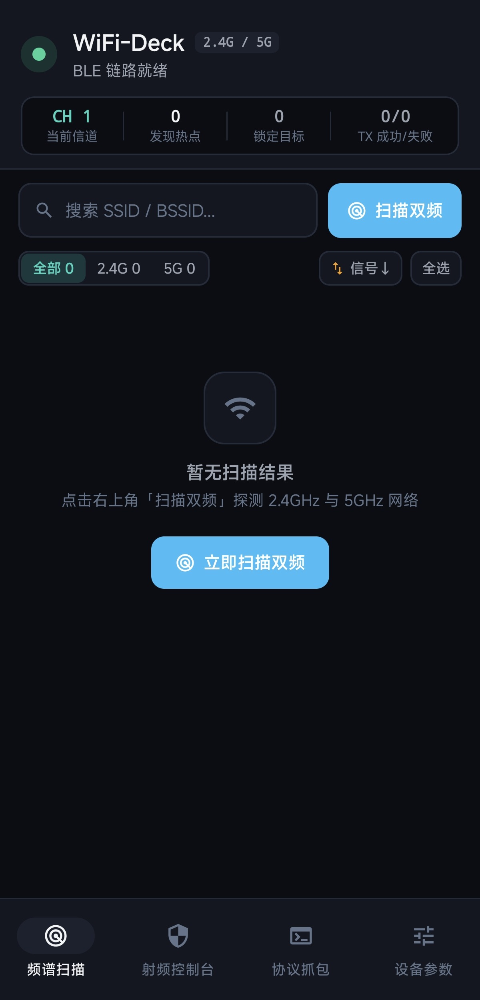
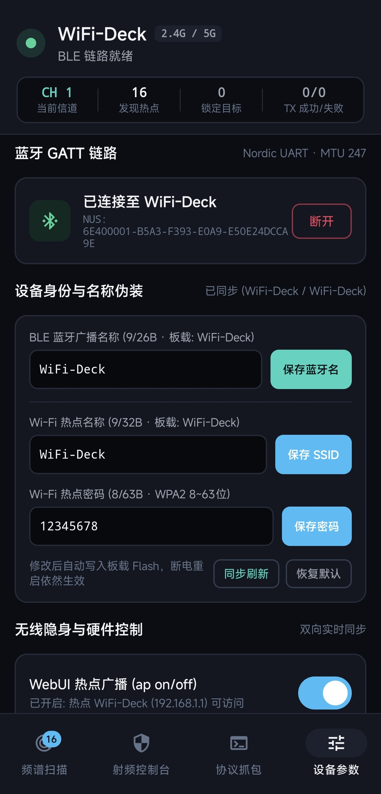
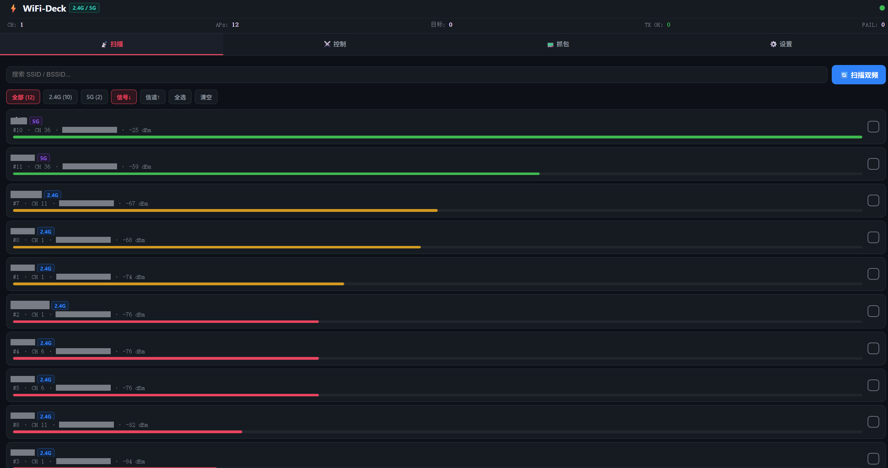
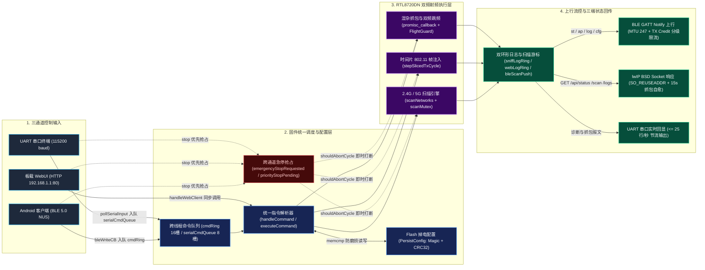

# WiFi-Deck


-blue)


基于 **Ai-Thinker BW16-Kit（Realtek RTL8720DN）** 的便携式 **2.4GHz / 5GHz 双频 Wi-Fi 安全测试与 802.11 协议分析工具**。  
支持 **BLE 5.0 原生 Android 客户端**、**板载暗色 WebUI** 与 **UART 串口 CLI** 三种控制方式，无需在开发板上外接屏幕或按键；通过手机蓝牙控制时，手机可继续使用移动数据正常上网，且在混杂抓包、跨频段跳频或关闭热点（`ap off`）隐身时依然保持实时连接。

> ⚠️ **免责声明**：本项目仅用于无线安全教学、802.11 协议研究及已获得明确书面授权的渗透测试。严禁用于任何未授权的网络干扰或非法用途，使用者须自行承担相应法律责任。

---

## 一、界面预览与功能布局

### 1. Android 客户端（BLE 5.0）

<p align="center">
  
  &nbsp;&nbsp;
  
</p>

### 2. 板载暗色 WebUI（`http://192.168.1.1`）

<p align="center">
  
</p>

### 3. 三端功能对照

| 模块 | Android 客户端（BLE 5.0，推荐） | 板载 WebUI（`http://192.168.1.1`） | UART 串口 CLI（`115200`） |
|---|---|---|---|
| **状态与遥测** | BLE 连接态、重连进度、当前信道、热点/目标/TX 统计、一键急停 | 轮询 `/api/status`、运行状态、TX 计数、BLE 在线提示、一键急停 | 实时打印启动诊断、信道切换、TX 统计与 `stop` 急停 |
| **1. 频谱扫描** | 2.4G / 5G 频段计数过滤、SSID/BSSID 搜索、RSSI 排序、多选/全选 | 2.4G / 5G 频段标签、信号条、动态扫描倒计时、多目标勾选 | `scan`、`results`、`set target <i,j\|all>` |
| **2. 射频控制台** | Deauth / Disassoc / 单目标点射 / Flood / Jam / 定时测试、运行态高亮 | 已选目标概览、定时压测、零目标防误攻拦截与单目标点射 | `start deauther`、`disassoc`、`single_ap`、`attack_time`、`beacon_flood`、`probe_flood`、`signal_jam`、`deauth_sniff` |
| **3. 协议抓包** | 6 种过滤模式、自动跳频、常用双频信道锁定、滚屏锁、导出分享、双端同步清空 | 查看抓包历史 `/api/logs`；Web 端触发抓包自动按 `15s` 定时并在结束后重连恢复 | `start sniff`、`sniff <mode>`、`sniff_time`、`hop on/off`、`set ch`、`clear_logs` |
| **4. 设备参数** | 自定义 BLE 名称 / 热点 SSID / 密码（保存写 Flash，按 `RST` 重启生效）、`ap off` 隐身开关、参数防抖同步 | 运行参数修改、密码脱敏读取（留空不改）、恢复默认（禁止 `ap off` 防断联） | `set <key> <val>`、`ap on/off`、`info`、`reset_config` |

---

## 二、BW16 硬件能力与三通道控制设计

### 1. 关于 BW16（Realtek RTL8720DN）硬件平台

**Ai-Thinker BW16-Kit** 开发板搭载安信可 BW16 双频无线模组（核心 SoC 为 **Realtek RTL8720DN**），内部采用 **ARM V8（KM4，兼容 Cortex-M4F）高性能核 + ARM V8M（KM0，兼容 Cortex-M0）低功耗核** 双核架构，单芯片原生集成：
- **2.4GHz + 5GHz 双频 Wi-Fi（802.11 a/b/g/n）**：同时覆盖 2.4GHz（CH 1–13）与 5GHz（CH 36–165）频段，底层支持 SoftAP 热点、STA 双频扫描、802.11 原始管理帧注入（Raw Frame TX）以及混杂模式（Promiscuous Mode）空中报文监听。
- **BLE 5.0 低功耗蓝牙**：具备独立的蓝牙协议栈与 GATT 外设服务能力（与 Wi-Fi 共用天线），可在 Wi-Fi 射频高负载切换信道或关闭热点的同时维持蓝牙通信。
- **板载硬件资源**：Type-C 接口供电（建议 `5V > 500mA`）与板载 **CH340C** USB 转串口（接 `PA7_LOG_TX` / `PA8_LOG_RX`）、三色 RGB LED（`PA12` / `PA13` / `PA14`），以及 **`RST`** 复位键与 **`BURN`** 烧录键。

> **官方硬件文档归档（[docs/hardware/](docs/hardware/)）**：
> - [BW16-Kit_V1.2.3_Specification.pdf](docs/hardware/BW16-Kit_V1.2.3_Specification.pdf) — BW16-Kit 开发板官方规格书（引脚定义、电气与射频参数、按键与 LED 说明）
> - [BW16-Kit_V1.2_Schematic.pdf](docs/hardware/BW16-Kit_V1.2_Schematic.pdf) — BW16-Kit V1.2 开发板原理图（Type-C / CH340C 自动下载电路与 GPIO 连接）
> - [BW16_V1.2.2_Datasheet_CN.pdf](docs/hardware/BW16_V1.2.2_Datasheet_CN.pdf) — BW16 模组中文规格书（RTL8720DN 架构、天线布局与供电设计指导）

### 2. 为什么主打“蓝牙（BLE 5.0）控制”？

- **免板载外设，无需在开发板上操作**：开发板无需焊接屏幕或控制按键，也不必全程插着电脑串口，只需接上 USB 电源或充电宝即可独立工作，全部交互在手机或浏览器端完成。
- **解决“连板载热点导致断网”与“抓包断联”问题**：
  - **连接板载 Wi-Fi 热点（WebUI）的局限**：开发板发出的 `WiFi-Deck` 热点本身不接外网。如果电脑通过无线网卡连上 `WiFi-Deck`，电脑就无法再通过 Wi-Fi 上网；手机连上该热点后也只能靠移动数据上网（部分系统还会因 Wi-Fi 无网弹窗或切网）。此外，开发板只有一套 Wi-Fi 射频，一旦切入混杂模式抓包或执行 `ap off` 关闭热点，Wi-Fi 热点必然中断。
  - **使用 BLE 5.0 蓝牙控制（Android App）的优势**：
    - **手机正常上网**：控制指令与抓包数据全部走独立的 BLE 5.0 通道，手机无需连接开发板热点，**可以直接使用 4G/5G 移动数据（或正常连接有网的路由器 Wi-Fi）保持流畅上网**；同时无论开发板正在跨频段跳频、混杂抓包还是开启 `ap off` 隐身模式关闭热点，蓝牙控制链路全程不断线。
    - **App 内一键直连，不影响蓝牙耳机**：直接在 `WiFi-Deck` App 内点击连接即可（无需去手机系统蓝牙设置里手动配对）；且开发板使用的是 **BLE GATT 低功耗数据通道**，与蓝牙耳机的音频通道（经典蓝牙 A2DP / HFP）完全独立，**连接开发板的同时可以正常佩戴蓝牙耳机听歌或通话，互不干扰**。

### 3. 三种控制方式协同与适用场景

项目同时支持 **BLE 5.0 Android 客户端**、**板载 WebUI** 与 **UART 串口 CLI** 三种控制方式，三端共享底层状态与配置：

| 控制方式 | 连接入口 | 核心特点与适用场景 |
|---|---|---|
| **1. BLE 5.0 Android 客户端（主力推荐）** | 打开 `WiFi-Deck` App 点击顶部“连接”（无需系统设置配对） | **不占 Wi-Fi（可用移动数据或路由器上网）、不影响蓝牙耳机**；支持前台服务保活、断线自动重连、混杂抓包实时流式查看与导出、以及 `ap off` 无线隐身模式，适合日常与外场便携使用。 |
| **2. 板载暗色 WebUI** | 连热点 `WiFi-Deck`（密码 `12345678`），浏览器打开 `http://192.168.1.1` | **免安装任何 App**，手机或电脑浏览器即开即用；针对混杂抓包做了 `15s` 定时自动恢复热点设计（注意：单无线网卡电脑连此热点期间无法通过 Wi-Fi 上外网）。 |
| **3. UART 串口 CLI** | USB 连接电脑串口（波特率 `115200`） | 支持全部底层命令与实时射频/内存诊断日志输出，适合桌面调试、固件开发与脚本自动化控制。 |

---

## 三、系统架构与工程设计

### 1. 整体架构图



### 2. 固件端架构细节（`WiFi-Deck.ino`）

- **三通道指令接入与毫秒级急停抢占**  
  - **异步通道解耦**：BLE 写回调（`bleWriteCB`，运行于蓝牙协议栈线程）将指令写入临界区保护的 16 槽环形队列 `cmdRing`，绝不阻塞蓝牙任务；串口输入（`pollSerialInput`）通过非阻塞行缓冲写入 8 槽队列 `serialCmdQueue`，由 `loop()` 顺序出队交给 `handleCommand` / `executeCommand`。
  - **HTTP 同步执行**：WebUI 请求（`handleWebClient`）解析 `/api/command`、`/api/target`、`/api/config` 后直接调用 `executeCommand(..., fromHttp = true)`，以便同步向浏览器返回准确的 HTTP `200` / `400` / `403` JSON 响应。
  - **跨通道急停抢占**：任意通道收到 `stop` 指令时，立即置位 `emergencyStopRequested` 与 `priorityStopPending`；发包引擎采用时间片状态机 `stepSlicedTxCycle`（每轮默认切片最多发送 8 帧并喂狗），配合 `shouldAbortCycle()` 在扫描等待与每帧发送间隙实时检测急停标志，实现毫秒级中断。
- **双频射频并发与双环形日志缓冲**  
  - **扫描互斥与非阻塞分步推送**：底层异步扫描回调 `scanResultHandler` 与主循环读取通过 FreeRTOS 互斥锁 `scanMutex` 同步；向 BLE 推送扫描列表时，通过游标状态机 `pumpBleScanPush` 在主循环中按 TX credit 余量分步非阻塞发送（区分主动扫描 `scan_begin`/`scan_end` 与周期同步 `sync_begin`/`sync_end`），避免热点较多时阻塞主循环。
  - **混杂回调保护与双日志环**：引入 `PromiscFlightGuard`（原子计数 `promiscCallbackInFlight`），在切换信道、发送克隆帧或退出混杂模式前等待在途回调完全退出；抓包报文经 UTF-8 安全裁剪后，同时写入 **24 槽实时流缓冲 `sniffLogRing`**（供主循环向 BLE / UART 消费输出）和 **32 槽 Web 历史缓冲 `webLogRing`**（供 `/api/logs` 在单次临界区内拷贝 4KB 快照后出锁拼装 JSON）。
  - **802.11 帧构造与防误攻校验**：`wifi_tx_raw_frame` 对驱动内部结构执行逐级指针判空与帧长边界（`<= 1500B`）检查，Beacon/Probe 帧构造器严格限制 SSID 长度（`<= 32B`）与 96B 栈缓冲边界；App 与 WebUI 均下发带目标索引的原子指令（如 `start deauther 0,2,5`），未选目标时直接拦截拒绝，全量测试必须显式传入 `all`。
- **BLE 上行分级背压流控（防止高负载断连）**  
  混杂抓包高峰期若无限制调用 BLE Notify 会耗尽协议栈 TX credit，导致每秒一次的 `st` 状态心跳饿死并触发 `0x0108` 连接监督超时。固件在 `bleSendSniffLog` 与主循环中实施分级流控：
  - **高优先级通道**：`EAPOL` 握手帧、`Deauth`、`Disassoc` 与 `Pwnagotchi` 报文仅需 `>= 1` 个剩余 credit（间隔 `>= 15ms`）即可优先下发；
  - **普通日志自适应退避**：普通管理/控制帧要求剩余 `>= 3` 个 TX credit（为状态心跳与控制响应预留余量），并根据当前有效 ATT MTU 在 `100ms–800ms` 之间动态退避限流。
- **直连 lwIP BSD Socket 的 WebUI 自愈服务**  
  固件直接使用 lwIP BSD Socket 构建端口 80 HTTP 服务（显式开启 `SO_REUSEADDR` 与断开排空，并用 `#undef` 隔离 POSIX 宏污染）。当用户在无 BLE 连接的纯 WebUI 模式下触发抓包时，固件先完整刷出 HTTP 200 响应并关闭连接，再切入 `15s` 定时混杂监听；到期后自动恢复 SoftAP 与端口 80 监听，前端页面倒计时结束后自动重连回读 `/api/logs`。
- **Flash 掉电配置与防磨损机制（`PersistConfig`）**  
  自定义热点 SSID/密码、BLE 广播名及射频参数存储在 Flash 中，包含 `CFG_MAGIC`（`0x57444B33`）、版本号与 `CRC32` 校验。调用 `saveConfigToFlash` 时先通过 `memcmp` 比对，内容未发生实际变化时跳过 Flash 擦写与广播更新。

### 3. Android 客户端架构细节（`AndroidApp/`）

- **GATT 串行状态机与两阶段重连自愈（`BleManager` + `BleReconnectTracker`）**  
  Android 原生 `BluetoothGatt` 操作异步且不可并发。`BleManager` 将“BLE 扫描 → 物理建链 → 请求 `MTU = 247` → 发现 NUS 服务 → 写入 CCCD 启用 Notify → 自动下发 `info` 与 `results` 同步状态”封装为带独立超时的串行状态机，并通过有界命令队列 + `WriteAckTracker`（`60ms` 写确认超时与最少 `25ms` 帧间隔，`stop` 享有队首插队优先级）管理指令发送。意外断线时，`BleReconnectTracker` 先执行 1 次 `4.5s` 快速直连，失败后立即切换为 BLE 扫描兜底重连（最多 5 轮退避重试），并监听系统蓝牙开关广播防止竞态死锁。
- **前台保活服务（`BleKeepAliveService`）**  
  在连接建立或重连期间自动启动 `connectedDevice` 类型前台服务与低打扰常驻通知（支持通知栏一键断开），防止手机息屏或切后台后系统回收 BLE 连接。
- **字节级 UTF-8 换行分帧器（`BleProtocol`）**  
  针对 BLE 分片传输可能导致多字节 UTF-8 字符（如中文 Wi-Fi 名称）跨包被截断成乱码（`\uFFFD`）的问题，客户端使用纯 Kotlin 字节级缓冲 `BleLineFramer`（单行上限 `4096B`），严格按 `\n` 字节边界切出完整帧后再统一解码 UTF-8，并根据当前协商的 `_mtu` 自动校验单条指令字节长度。
- **单消费者状态流与 `75ms` 合批渲染（`MainViewModel` + Jetpack Compose）**  
  BLE Binder 线程收到的每行 JSON 先写入无限容量 `Channel`，由 `MainViewModel` 在主线程单消费者协程中每轮最多处理 64 条后 `yield()`，彻底消除多线程读写竞态；针对高频抓包日志与扫描结果，使用 500 槽 `ArrayDeque` 与 `LinkedHashMap` 进行 **`75ms` 窗口合批刷新**，配合下沉式派生 `StateFlow`（隔离顶栏、角标与各 Tab 重组范围）及 `SaveableStateProvider`，在持续高负载抓包下保持界面流畅。

---

## 四、快速开始

### 1. 硬件与环境准备

- **硬件**：**Ai-Thinker BW16-Kit** 开发板（搭载 BW16 / RTL8720DN 模组）及支持数据传输的 USB 线。
- **固件编译环境**：Arduino IDE 2.x 或 `arduino-cli`，安装开发板核心 **Realtek Ameba Boards (AmebaD)**（推荐版本 **`3.1.7`**），附加开发板管理器地址：
  ```text
  https://github.com/ambiot/ambd_arduino/raw/main/Arduino_package/package_realtek_amebad_index.json
  ```
- **Android 运行/编译环境**：手机需 **Android 8.0+**（`minSdk 26`，`targetSdk 36`）；本地编译源码需 **JDK 17+** 与 **Android SDK 36**（Build Tools `35.0.0`）。

### 2. 烧录固件

1. 用 Arduino IDE 打开仓库根目录的 `WiFi-Deck.ino`，开发板选择 **`Ai-Thinker BW16 (RTL8720DN)`**。
2. **进入烧录模式**：按住开发板上的 **`BURN`** 键不放 → 短按一下 **`RST`** 键 → 松开 **`BURN`** 键。
3. 选择对应串口并点击上传（串口监视器波特率为 **`115200`**）。

若使用 `arduino-cli` 命令行编译与烧录：
```bash
arduino-cli compile --clean --fqbn realtek:AmebaD:Ai-Thinker_BW16 --warnings all .
arduino-cli upload -p COM6 --fqbn realtek:AmebaD:Ai-Thinker_BW16 .
```

### 3. 三种连接与使用方式

- **方式一：BLE 5.0 Android 客户端（推荐，不占 Wi-Fi 可正常上网）**
  1. 前往 [Releases](https://github.com/xiangwen-ctrl/WiFi-Deck/releases/latest) 页面下载最新的 **`WiFi-Deck-v2.0.apk`** 并安装到手机。
  2. 打开 App，按提示授予蓝牙与位置权限，**直接在 App 内点击顶部“连接”按钮**即可自动扫描直连 `WiFi-Deck`（无需去系统蓝牙设置里手动配对；连接期间手机可继续使用移动数据或路由器 Wi-Fi 上网，也不影响同时连接蓝牙耳机）。
- **方式二：板载免安装 WebUI**
  1. 手机或电脑连接开发板 Wi-Fi 热点（默认名称：**`WiFi-Deck`**，默认密码：**`12345678`**）。
  2. 浏览器访问 **`http://192.168.1.1`** 即可打开控制台。
- **方式三：UART 串口 CLI**
  1. 使用串口调试工具或 Arduino 串口监视器连接开发板（波特率 **`115200`**）。
  2. 发送 `help` 查看完整命令说明，发送 `scan`、`start deauther 0`、`sniff all`、`stop` 等命令即可直接控制。
- **附：从源码本地构建 Android App 与运行单元测试**
  ```bash
  cd AndroidApp
  ./gradlew testDebugUnitTest assembleDebug --no-daemon
  ```
  > Windows PowerShell 下请使用 `.\gradlew.bat`，生成的安装包位于 `AndroidApp/app/build/outputs/apk/debug/app-debug.apk`。

---

## 五、目录结构与命令协议参考

### 目录结构

```text
WiFi-Deck/
├── WiFi-Deck.ino                          # RTL8720DN 固件源码（射频收发/混杂抓包/BLE NUS/lwIP WebUI/UART CLI）
├── AndroidApp/                            # 原生 Android 客户端 (Kotlin + Jetpack Compose + MVVM)
│   └── app/src/
│       ├── main/java/io/github/xiangwen/wifideck/
│       │   ├── MainActivity.kt            # 权限/蓝牙/定位门禁链与系统蓝牙广播监听
│       │   ├── data/
│       │   │   ├── BleManager.kt          # BLE 扫描、连接、MTU 协商、串行写队列与超时控制
│       │   │   ├── BleReconnectTracker.kt # 断线重连状态机（快速直连切扫描 + 退避）与 ACK 追踪
│       │   │   ├── BleProtocol.kt         # UTF-8 字节级换行分帧器与 MTU 载荷编解码
│       │   │   ├── BleKeepAliveService.kt # connectedDevice 前台保活服务
│       │   │   └── Models.kt              # 状态、配置、热点与抓包日志数据模型
│       │   └── ui/
│       │       ├── MainViewModel.kt       # 业务状态流、75ms 日志合批节流与防误攻校验
│       │       ├── MainScreen.kt          # 底部四标签页导航与页面状态保持
│       │       ├── components/            # 顶部遥测仪表盘、门禁弹窗与公共卡片
│       │       ├── tabs/                  # ScanTab / ControlTab / SniffTab / SettingsTab
│       │       └── theme/                 # 暗色主题配色
│       └── test/java/io/github/xiangwen/wifideck/
│           ├── data/BleProtocolTest.kt
│           ├── data/BleReconnectTrackerTest.kt
│           ├── data/ModelsTest.kt
│           └── ui/MainViewModelTest.kt
├── docs/
│   ├── hardware/                          # BW16-Kit 官方规格书与原理图 PDF
│   └── screenshots/                       # Android 客户端与 WebUI 界面截图
├── .github/workflows/android.yml          # 单元测试、APK 构建与 Tag 自动发版 CI
├── LICENSE
└── README.md
```

<details>
<summary>📡 展开查看：完整串口/BLE 控制指令、BLE JSON Lines 协议与 HTTP API</summary>

#### 1. 统一控制指令（UART / BLE 共用，单条上限 219B，以 `\n` 结尾）
```text
# 扫描与查询
scan                        results                     info                    help
tx_stats                    reset_txstats

# 射频测试（未选目标拒绝无参攻击，全量测试需显式传 all）
start deauther <i,j|all>    disassoc <i,j|all>          single_ap <index>       random_attack
attack_time <ms> <i,j|all>  stop [all|deauther]

# Flood / Jam / 嗅探克隆
beacon_flood                probe_flood                 signal_jam              deauth_sniff

# 混杂抓包与信道跳频
start sniff                 sniff all|beacon|probe|deauth|eapol|pwnagotchi
sniff_time <ms> [mode]      stop sniff                  clear_logs
hop on                      hop off                     set ch <channel>

# 参数配置与热点控制（写入 Flash 掉电记忆；ap off 仅允许 BLE 与串口）
set target <i,j,k|all>      set num_frames <n>          set cycle_delay <ms>    set scan_time <ms>
set start_channel <c>       set scan_cycles on|off      set led on|off          ap on|off
set ble_name <name>         set ap_ssid <ssid>          set ap_pass <pass>      reset_config
```

#### 2. BLE GATT（Nordic UART Service）与上行 JSON Lines
- **Service UUID**：`6E400001-B5A3-F393-E0A9-E50E24DCCA9E`
- **RX (Phone → Board)**：`6E400002-B5A3-F393-E0A9-E50E24DCCA9E`（`Write` / `Write Without Response`）
- **TX (Board → Phone)**：`6E400003-B5A3-F393-E0A9-E50E24DCCA9E`（`Notify`）

| `t` 类型 | 用途 | 核心字段 |
|---|---|---|
| `scan_begin` / `scan_end` | 主动扫描起止 | `n`：热点数量（失败附 `err: 1`） |
| `sync_begin` / `sync_end` | `results` 回读或间隙重扫同步 | `n`：热点数量（不触发主动扫描超时） |
| `ap` | 单条扫描热点 | `i`：索引，`s`：SSID，`b`：BSSID，`c`：信道，`r`：RSSI，`sel`：选中标志 |
| `st` | 每秒或状态变更心跳 | `atk`/`dis`/`bcn`/`prb`/`jam`/`snf`、`snfOn`、`sMode`、`hop`、`ch`、`ok`/`fail`、`rem` |
| `cfg` / `id` | 运行配置与设备身份同步 | `delay`、`scan`、`frames`、`ch`、`sc`、`led`、`ap` / `ssid`、`pass`、`ble` |
| `log` | 抓包报文与系统提示 | `m`：单行日志文本 |

#### 3. WebUI HTTP API（`192.168.1.1:80`，同源访问）
| 路由 | 方法 | 说明 |
|---|---|---|
| `/` | `GET` | 内置暗色 WebUI 页面 |
| `/api/scan` | `GET` / `POST` | 读取扫描缓存 / 触发双频扫描 |
| `/api/status` | `GET` | 查询运行状态、当前信道、TX 统计与 `ble_connected` |
| `/api/info` | `GET` | 查询配置参数（`pass` 字段脱敏返回空字符串） |
| `/api/logs` / `/api/logs/clear` | `GET` / `POST` | 读取抓包历史 / 双端同步清空日志 |
| `/api/command` / `/api/target` / `/api/config` | `POST` | 执行控制指令（禁止 `ap off`）、更新目标索引、保存 Flash 配置 |

</details>

---

## 六、常见问题排查（FAQ）

1. **点击上传固件时提示串口连接超时 / 无法进入烧录模式？**
   - 请确认使用的是支持数据传输的 USB 线并已安装串口驱动（如 CH340）。
   - 上传前需手动进入下载模式：**按住 `BURN` 键不放 → 短按 `RST` 键 → 松开 `BURN` 键**，此时再点击上传。
2. **开启全频段发包或扫描时，开发板偶尔自动重启？**
   - 双频 Wi-Fi 连续发射时的瞬态电流较大，部分电脑前置 USB 口或劣质延长线压降过大，会触发芯片欠压保护复位（Brownout Reset）。建议更换主板后置 USB 口或使用供电充足的独立 5V USB 电源。
3. **手机 App 点击连接一直扫描不到设备？**
   - **Android 8–11 系统**：系统底层要求必须同时开启手机的**“位置信息（GPS）”总开关**才能返回 BLE 扫描结果。
   - **单连接限制**：BW16 的 BLE 外设同一时间仅维持 1 个主机连接，若已被另一台手机连接，请先断开或按 `RST` 复位开发板。
4. **在 WebUI 点击开始抓包后，网页为什么会暂时断开？**
   - RTL8720DN 进入 802.11 混杂监听模式时必须关闭 SoftAP 热点。WebUI 触发抓包会自动按 `15s` 定时运行，倒计时结束后固件自动恢复热点与 80 端口服务，网页会自动重连并拉取抓包结果。如需长时间连续抓包，请使用 BLE Android 客户端。
5. **修改自定义 Wi-Fi 名称/密码或 BLE 蓝牙名称后，需要按一下开发板上的 `RST` 键吗？**
   - **是的，建议修改后按一下板载 `RST` 键重启开发板。** 点击保存时，新的热点 SSID、密码或蓝牙名称已经立即写入板载 Flash（带 CRC32 校验，断电不丢失）。但由于修改蓝牙名称时手机正处于 BLE 连接状态（此时外设停止广播，且手机系统蓝牙会按 MAC 缓存已连接设备的旧名称），同时无线驱动在连接态下热切换 AP 参数存在系统缓存延迟，直接按一下开发板上的 `RST` 键复位重启是最稳妥、立刻生效的方式。

---

## 七、版本记录

- **v2.0**：修复固件 802.11 帧构造边界与混杂模式/扫描并发隐患，WebUI 改用直连 lwIP BSD Socket 解决抓包恢复时 80 端口绑定失败问题，加入 BLE 抓包分级背压限流与 `PersistConfig` CRC32 校验；Android 端新增前台保活服务、重连状态机、权限/定位门禁、75ms 日志合批渲染与 32 个单元测试，CI 接入单测门禁与 Tag 自动发版。
- **v1.6**：完善 2.4G/5G 全信道跳频与 `ap off` 隐身模式，Android 客户端重构为四标签页结构，支持持久化自定义 AP 与 BLE 名称。
- **v1.5**：完成双频扫描/攻击/抓包基础固件、内置 WebUI 与初版 BLE Android 客户端。

---

## 八、致谢与开源协议

- 感谢 [7h30th3r0n3/Evil-BW16](https://github.com/7h30th3r0n3/Evil-BW16) 与 [tesa-klebeband/RTL8720dn-Deauther](https://github.com/tesa-klebeband/RTL8720dn-Deauther) 在 RTL8720DN 802.11 底层研究上的开源参考。
- 本项目基于 [MIT License](LICENSE) 开源。
